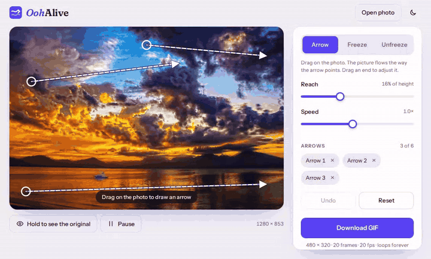
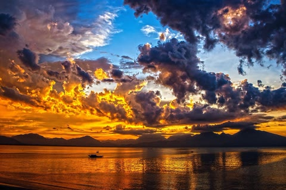
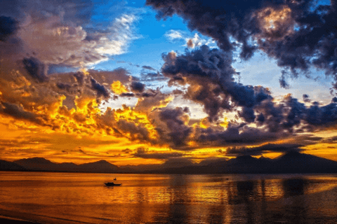

<p align="center">
  
</p>

<h1 align="center">OohAlive</h1>

<p align="center"><i>You draw a line. The clouds follow it. You say ooh.</i></p>

<p align="center">
  <a href="https://github.com/Arthur031221/OohAlive/actions/workflows/ci.yml"></a>
  
  <a href="https://arthur031221.github.io/OohAlive/"></a>
</p>

<p align="center">
  Draw an arrow on a photo and the picture flows that way. Download the loop as a GIF.<br>
  Free, no account, no watermark, and the photo never leaves your browser.
</p>

<p align="center">
  <b>887 KiB</b> GIF, <b>1.6 s</b> to export, <b>0</b> requests after the page loads<br>
  <sub>Measured by <code>npm run verify</code> on the built page: Chromium 153 with software WebGL, the bundled photo with its three arrows and the frozen boat. Method under <a href="#numbers">Numbers</a>.</sub>
</p>

<p align="center">
  
</p>

<p align="center"><a href="https://arthur031221.github.io/OohAlive/"><b>Open the live page</b></a></p>

## Before and after

| Before | After |
| :---: | :---: |
|  |  |

Three arrows push the clouds and the water. One brush stroke keeps the boat where it is. The right side is the real file the page downloads.

No subscription, no upload form, no watermark. The page is one HTML file.

## Five steps

1. Open the page. A photo is already moving, so you can see what an arrow does.
2. Open your own photo, or drop or paste one onto the page.
3. Drag on the photo to draw an arrow. Up to six. Drag an end to aim it, and use Reach and Speed to tune it.
4. Pick Freeze and paint over whatever should stay still, like a boat, a face or a sign. Hold the button or press O to compare with the original.
5. Download GIF.

## Numbers

| What | Result | How it was measured |
| --- | --- | --- |
| GIF file | 887 KiB, 480 x 320, 20 frames at 20 fps, loops forever | The built page served over local HTTP. The script clicks Download GIF, saves the file, and reads it back with an independent decoder (omggif). |
| Export time | 1.6 s | From the click to the browser's download event, in headless Chromium 153 with software WebGL. I'd expect a real GPU to be faster, but I haven't measured one. |
| Requests after load | 0 | The server logged every request while the page loaded, drew, and exported. The only one was the page itself. A Content Security Policy in the page also blocks `fetch`, XHR, WebSocket, images and fonts from any outside address, and a test fires a `fetch` to check that. |
| Frozen area | 0 of 4,617 colour values changed | A 9 by 9 pixel window on the frozen boat, compared across all 20 frames of the downloaded file. |
| Loop seam | last to first frame differs by 1.90, a normal step is 1.78 | Mean absolute difference in RGB levels. The jump back to the start is about the size of any other step. |
| GIF against the shader | worst frame 32.9 dB PSNR | Each decoded GIF frame against what the shader drew at the same phase. A GIF has 256 colours, so it can't match exactly. |

Run it yourself with `npm run verify`. It fails on a wrong size or frame count, a jump at the loop seam, any change in the frozen area, any request after load, or a frame more than 30 dB from the shader. The file size and the export time are reported but not checked, since they depend on the machine.

## How it works

Each arrow pulls the pixels near it along its direction, with a smooth falloff set by Reach. Two copies of the photo slide along that flow half a loop apart and cross fade, so one copy always covers the moment the other resets and the loop has no seam. The freeze brush paints a mask, and where the mask is set the flow is zero.

The preview and the export call the same draw function, so the loop you watch is the loop you get. The GIF writer builds one palette for the whole loop and adds an ordered dither so skies don't band. Any pixel that equals the previous frame is left transparent, so still regions cost almost nothing and don't shimmer.

## Install

You don't have to. The [live page](https://arthur031221.github.io/OohAlive/) is the app. If you want your own copy:

<details>
<summary>One file on your disk</summary>

```sh
curl -LO https://github.com/Arthur031221/OohAlive/raw/main/dist/index.html
```

Open `index.html` in a browser. It makes no outside requests, so it works offline.
</details>

<details>
<summary>From source</summary>

```sh
git clone https://github.com/Arthur031221/OohAlive
cd OohAlive
npm ci
npm run build   # writes dist/index.html
```

Node 22 or newer.
</details>

<details>
<summary>Run the tests</summary>

```sh
npm test                          # unit tests in plain Node
npx playwright install chromium
npm run test:e2e                  # the page in a real browser
npm run verify                    # downloads a GIF and checks the file
```
</details>

## What it does not do

- It moves a photo along arrows. There's no depth, no parallax and no sky swap.
- It works best on water, clouds, smoke, fabric and anything else that flows. It won't make a person walk, and a face under an arrow will wobble. Freeze it.
- The GIF is at most 480 pixels on its long edge and one second long. Photos are reduced to 1600 pixels on the long edge for editing.
- Arrows and brush strokes need a mouse, a finger or a pen. You can move and delete existing arrows from the keyboard.
- Needs WebGL 2. Without it the page says so instead of showing a broken editor.
- Tested in Chromium, including emulated touch. I haven't run it in Firefox or Safari, or on a real phone, so treat those as untested.

## Credits

The sunset is "Yellow clouds at sunset" by PublicDomainPictures and the waterfall used in the demo recording is "Waterfall in forest" by Martin Eklund. Both are CC0 on Wikimedia Commons, with sources in [`assets/photos`](assets/photos/README.md). The GIF encoder is [gifenc](https://github.com/mattdesl/gifenc). Fonts are Fraunces and Instrument Sans, under the SIL Open Font License.

## License

MIT. See [LICENSE](LICENSE) and [CONTRIBUTING](CONTRIBUTING.md).

Assisted by Claude/Codex.
